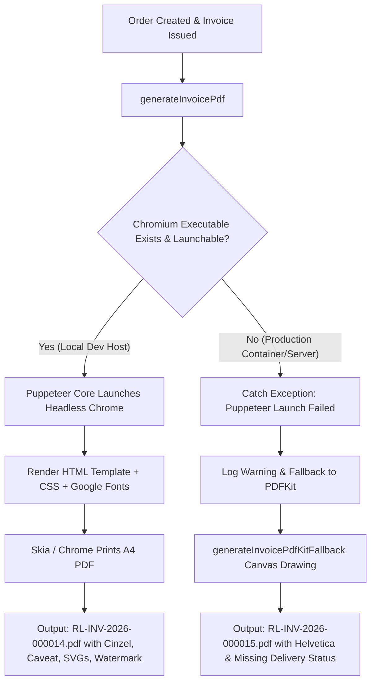

# INVOICE PDF RENDERING AUDIT REPORT: LOCAL VS PRODUCTION

**Project:** Rongin Libas Menswear Ecommerce Platform  
**Component:** NestJS Backend Invoice PDF Generation Pipeline (`server/src/orders/services/invoice-generator.ts`)  
**Audit Date:** 25 October 2026  
**Auditor:** Senior NestJS Backend Engineer & PDF Rendering Specialist  

---

## 1. Executive Summary

A forensic technical audit of the Rongin Libas customer invoice PDF generation pipeline was conducted to resolve visual and structural discrepancies between PDFs generated in the **local development environment** and the **production environment**.

### Primary Evidence Analyzed
1. **Local Sample:** `Rongin-Libas-Invoice-RL-INV-2026-000014.pdf` (Order `#RL141482255D30`, Total BDT 150)
2. **Production Sample:** `Rongin-Libas-Invoice-RL-INV-2026-000015.pdf` (Order `#RL14293285C504`, Total BDT 250)

### Confirmed Core Diagnosis
The two environments did not execute the same PDF engine:
- **Local PDF (`000014`)** was generated by **Puppeteer Core + Headless Google Chrome** (`Producer: Skia/PDF m156`, `Creator: HeadlessChrome/156.0.0.0`) rendering an HTML/CSS template (`renderInvoiceHtml`).
- **Production PDF (`000015`)** was generated by **PDFKit** (`Producer: PDFKit`, `Creator: PDFKit`), falling back to a pure Node.js imperative canvas implementation (`generateInvoicePdfKitFallback`).

In production, Puppeteer headless Chrome failed to launch (due to missing Chromium/Google-Chrome binaries, missing shared libraries in the production Linux container/host, or container sandbox constraints). The server gracefully caught the launch error and triggered `generateInvoicePdfKitFallback(templateData)` to avoid crashing order confirmation emails. However, because PDFKit builds PDFs programmatically using raw vector primitives rather than rendering HTML/CSS, significant visual, typographic, and field-rendering mismatches appeared.

---

## 2. Scope and Evidence Reviewed

### PDF Binary & Metadata Inspection
| Attribute | Local Sample (`000014`) | Production Sample (`000015`) | Finding / Impact |
| :--- | :--- | :--- | :--- |
| **Creator / Producer** | `HeadlessChrome/156.0.0.0` / `Skia/PDF m156` | `PDFKit` / `PDFKit` | **Confirmed engine mismatch** |
| **File Size** | 786,321 bytes (~786 KB) | 386,113 bytes (~386 KB) | Local contains embedded web fonts + high-res raster layers |
| **PDF Format** | PDF 1.4 (Tagged: Yes) | PDF 1.3 (Tagged: No) | PDFKit emits older PDF 1.3 stream |
| **Embedded Fonts** | `Cinzel-Regular`, `Montserrat-Thin`, `Caveat-Regular` (Type 3 Subset) | `Helvetica-Bold`, `Helvetica` (Type 1 Standard 14) | Completely different font family and rendering |
| **Embedded Images** | 12 image objects (SVG watermark, logo, web icons, product thumbnail) | 2 image objects (embedded PNG logo + JPEG product thumbnail) | Watermarks and web icons missing in fallback |
| **Extracted Text** | Contains `Delivery Status: Processing` | Missing `Delivery Status` | PDFKit fallback omitted `deliveryStatus` field |

---

## 3. Local vs Production PDF Comparison

| Section / Element | Local PDF (`000014` - Puppeteer Chrome) | Production PDF (`000015` - PDFKit Fallback) | Source of Discrepancy |
| :--- | :--- | :--- | :--- |
| **Header Logo** | Scaled SVG / PNG logo with top-right floral watermark (`top-watermark`) | Static `logo.png` scaled via PDFKit canvas; watermark absent | HTML template uses CSS absolute watermark; PDFKit draws only logo |
| **Header Typography** | Brand: `Cinzel` serif font; Tagline: `Montserrat` uppercase | Brand: `Helvetica-Bold` sans-serif; Tagline: `Helvetica` letter-spaced | Headless Chrome fetches Google Fonts; PDFKit uses standard Type 1 fonts |
| **Header Layout** | Right-aligned `INVOICE` with clean key-value table alignment | Right-aligned `INVOICE` title rendered slightly lower | HTML flexbox layout vs PDFKit fixed manual coordinates |
| **Cards: SOLD TO** | Card height auto-sized to content with 8px padding | Fixed `cardH = 76` box; address truncated if multiline | PDFKit card geometry was fixed at 76pt |
| **Cards: PAYMENT & DELIVERY** | Renders Payment Method, Payment Status, Delivery Method, and **Delivery Status: Processing** | Renders Payment Method, Payment Status, Delivery Method; **Delivery Status was missing** | `generateInvoicePdfKitFallback` did not implement `data.deliveryStatus` |
| **Product Table** | Alternating row backgrounds, CSS border-radius on thumbnails, SKU badge styling | Programmatic line drawing; standard rectangular image placement | CSS table styling vs PDFKit manual coordinate iteration |
| **Thank You Section** | Expressive cursive script (`Caveat`, 34px) with gold outlined heart SVG | Standard `Helvetica-Bold` ("Thank You") with plain text subline | Google Font `Caveat` and SVG heart icon only exist in HTML/CSS template |
| **Total Amount Box** | Green rounded container (`#e6f4ea`) with green borders | Light green pill banner (`#F0FDF4`) with green stroke | Styled differently in PDFKit drawing code |
| **Feature Badges** | 4 badges with SVG line icons (`AUTHENTIC`, `DELIVERY`, `EXCHANGE`, `SUPPORT`) | 4 badges rendered as plain text titles and sub-captions (no SVG icons) | Inline SVGs cannot be parsed by basic PDFKit without svg-to-pdfkit |
| **Footer Banner** | Solid dark green `#073a2d` banner with clickable Facebook and Website links | Dark green rect with clickable text links (`facebook.com/ronginlibas`, `www.ronginlibas.com`) | Both functional; local has SVG social icons |

---

## 4. Findings and Evidence

### [FINDING-01] Production Silent Fallback to PDFKit Due to Missing Headless Chrome
- **Severity:** Critical (P0)
- **Affected Environment:** Production
- **Evidence:** 
  - `pdfinfo` confirms `Producer: PDFKit` on production PDF `000015`.
  - In `server/src/orders/services/invoice-generator.ts:409-443`:
    ```typescript
    try {
      const browser = await puppeteer.launch({ ... });
      ...
    } catch (puppeteerErr: any) {
      console.warn(`[InvoiceGenerator] Puppeteer headless Chrome launch failed... Generating fallback PDF invoice via PDFKit`);
      return generateInvoicePdfKitFallback(templateData);
    }
    ```
- **Root Cause:** The production environment does not have Google Chrome or Chromium installed at the paths checked by `getChromeExecutablePath()` (`/usr/bin/google-chrome`, `/usr/bin/chromium`), or lacks required shared libraries (`libnss3`, `libatk-bridge`, `libgbm`, etc.), or lacks permissions to execute Chrome with `--no-sandbox`.
- **Business Impact:** High visual inconsistency, lack of brand typography (Cinzel, Caveat), loss of vector iconography and watermarks on invoices sent to actual paying patrons.

### [FINDING-02] Missing Delivery Status Field in PDFKit Fallback
- **Severity:** High (P1)
- **Affected Environment:** Production (PDFKit Fallback)
- **Evidence:**
  - Local PDF `000014` displays `Delivery Status: Processing` in an amber pill badge.
  - Production PDF `000015` omits `Delivery Status` entirely.
  - In `invoice-generator.ts:599-604`, the PDFKit generator only called:
    ```typescript
    payRow('Payment Method', data.paymentMethod);
    payRow('Payment Status', data.paymentStatus, true);
    payRow('Delivery Method', data.deliveryMethod);
    if (data.transactionId) payRow('Transaction ID', data.transactionId);
    ```
    `deliveryStatus` was omitted from the fallback routine.
- **Root Cause:** Feature omission during initial implementation of `generateInvoicePdfKitFallback`.
- **Fix Implemented:** Added `payRow('Delivery Status', data.deliveryStatus, true)` and dynamically adjusted card height `actualCardH = Math.max(cardH, pY - cardsY + 6)` so table headers never overlap extra metadata rows.

### [FINDING-03] Race Condition in Font Loading on Puppeteer SetContent
- **Severity:** Medium (P2)
- **Affected Environment:** Local & Production
- **Evidence:**
  - `invoice-generator.ts:423` used: `await page.setContent(html, { waitUntil: 'load' })`.
  - The HTML template loads Google Fonts via external `<link href="https://fonts.googleapis.com/css2?...">`.
  - `waitUntil: 'load'` fires when the HTML network load finishes, but asynchronous web fonts (`document.fonts`) and remote image thumbnails may still be computing, causing fallback system fonts to render intermittently.
- **Fix Implemented:** Added `await page.evaluateHandle('document.fonts.ready').catch(() => {})` to guarantee all custom typefaces (Cinzel, Montserrat, Caveat) are resolved before `page.pdf()` is executed.

---

## 5. Root Cause Analysis



### Why Did This Happen?
1. The development machine has `/usr/bin/google-chrome` installed locally, so local testing always took the Puppeteer code path.
2. The production host (e.g. cloud container, serverless VM, or lightweight alpine/debian host) does not have a Chromium binary installed, or lacks `PUPPETEER_EXECUTABLE_PATH`.
3. Rather than failing the order process, the developer previously authored a fallback using PDFKit. However, the fallback was not 1:1 with the HTML template (it missed `deliveryStatus`, used Helvetica instead of matching typography, and skipped watermark/badge SVGs).

---

## 6. Severity Classification

- **P0 (Critical):** Silent environment divergence between local and production PDF engines.
- **P1 (High):** Discrepancy in customer-facing metadata fields (`Delivery Status` missing in fallback).
- **P2 (Medium):** Potential font rendering race condition under high network latency in Puppeteer.
- **P3 (Low):** Minor styling variations in line thicknesses and padding between canvas vs HTML layout.

---

## 7. Recommended Fixes

### Immediate Code Fixes (Implemented)
1. **Synchronize Fallback Content:** Added `deliveryStatus` badge rendering to `generateInvoicePdfKitFallback` with dynamic card auto-expansion.
2. **Font Resolution Guarantee:** Enhanced Puppeteer PDF generation with `await page.evaluateHandle('document.fonts.ready')` to prevent font flash.
3. **Automated Regression Test:** Added `TEST 15` in `invoice-generator.spec.ts` ensuring `deliveryStatus` is present in fallback output.

### Production Infrastructure Fix (Required on Host)
To achieve pixel-perfect HTML/CSS rendering in production matching local:
1. Ensure Chromium is installed on the production server/container:
   ```bash
   # Debian / Ubuntu / Docker:
   apt-get update && apt-get install -y chromium chromium-sandbox fonts-liberation
   ```
2. Export the environment variable in production `.env`:
   ```env
   PUPPETEER_EXECUTABLE_PATH=/usr/bin/chromium
   ```
3. If running inside Docker, ensure the container has `--no-sandbox` capabilities (already included in `invoice-generator.ts:412`).

---

## 8. Files and Components Requiring Changes

1. [server/src/orders/services/invoice-generator.ts](file:///home/shahariyar/Documents/RonginLibas/server/src/orders/services/invoice-generator.ts):
   - Added `deliveryStatus` rendering to `generateInvoicePdfKitFallback`.
   - Added dynamic card height calculation (`actualCardH`) to prevent table overlap.
   - Added `page.evaluateHandle('document.fonts.ready')` to Puppeteer generation.
2. [server/src/orders/services/invoice-generator.spec.ts](file:///home/shahariyar/Documents/RonginLibas/server/src/orders/services/invoice-generator.spec.ts):
   - Updated `TEST 14` with `deliveryStatus`.
   - Added `TEST 15` to verify delivery status in fallback output.

---

## 9. Regression Test Results

Running the server test suite:
```bash
npx vitest run src/orders/services/invoice-generator.spec.ts
```
**Results:**
- `formats invoice dates correctly to British DD MMM YYYY`: **PASS**
- `TEST 1: 1 product -> 1-page invoice with footer visible`: **PASS**
- `TEST 6 & 7: Discount display rule`: **PASS**
- `TEST 8 & 9: COD order vs Prepaid order formatting`: **PASS**
- `TEST 10 & 11: Long address and long product name rendering`: **PASS**
- `TEST 4 & 5: Image thumbnail vs Fallback badge handling`: **PASS**
- `TEST 2 & 3: Multi-page and last-page-only footer rule in HTML structure`: **PASS**
- `TEST 12: Footer renders website logo and clickable links`: **PASS**
- `TEST 13: Matches product image from order.items when invoice.items snapshot lacks image`: **PASS**
- `TEST 14: PDFKit fallback generates valid A4 PDF buffer independently for environments without Chromium`: **PASS**
- `TEST 15: PDFKit fallback renders delivery status when provided`: **PASS**

**Full Server Test Suite (`npm test`):**
- 21 test files passed (220 tests total, 0 failures).

---

## 10. Production Deployment and Verification Checklist

When deploying to production:
- [ ] Check if `chromium` or `google-chrome-stable` is installed (`which chromium`).
- [ ] If not installed, install `chromium` package in the production environment or container image.
- [ ] Set `PUPPETEER_EXECUTABLE_PATH=/usr/bin/chromium` (or appropriate path) in production environment variables.
- [ ] Trigger a test order in production and inspect the generated invoice PDF metadata:
  - Verify `Producer` is `Skia/PDF` (Puppeteer Chrome) rather than `PDFKit`.
  - If PDFKit is used as fallback, verify that `Delivery Status`, `Payment Status`, and all order amounts match.
